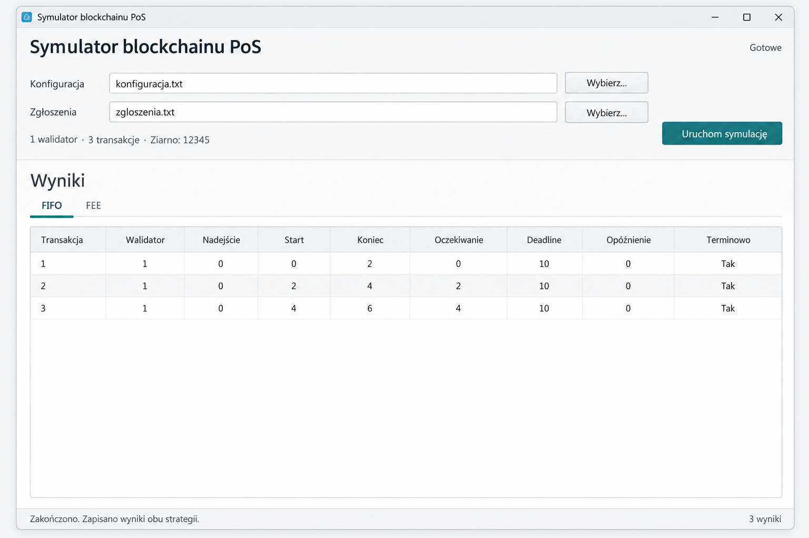

# Symulator blockchainu PoS — koncepcja interfejsu

**Status: projekt do późniejszej realizacji.** Ilustracja pokazuje proponowany wygląd; obecny program działa w terminalu. Kontekst PoS pozostaje uproszczonym modelem obsługi transakcji.

## Układ i korzyści

Jedno okno zawiera dwa wiersze wyboru plików, przycisk **Uruchom symulację** i dużą tabelę z zakładkami **FIFO** oraz **FEE**. Mniejszy nagłówek i oszczędne odstępy zostawiają miejsce na dane. Jasne tło, cienkie linie, systemowa czcionka i jeden stonowany akcent pomagają skupić się na wynikach.

Po poprawnym wczytaniu danych krótki wiersz pod polami pokazuje liczbę walidatorów, transakcji i ziarno losowania. To informacja o wejściu, nie statystyka przebiegu. Przycisk uruchamia oba warianty na tym samym zestawie danych.

Tabela prezentuje wszystkie pola już istniejącego wyniku: transakcję, walidatora, nadejście, start, koniec, oczekiwanie, deadline, opóźnienie i terminowość. Wiersze pozostają w kolejności zakończenia; pierwsza wersja nie potrzebuje sortowania i filtrowania. Zmiana zakładki przełącza widok zapisanych wyników bez ponownego liczenia. Pliki wynikowe nadal są zapisywane.

## Zachowanie okna

- **Przed uruchomieniem:** pusta tabela i komunikat „Wybierz pliki i uruchom symulację”.
- **Po wyborze lub zmianie pliku:** wczytanie i sprawdzenie obu wejść; poprawne dane aktualizują opis zestawu, a wcześniejsze wyniki są czyszczone. Przycisk uruchomienia jest dostępny dopiero dla poprawnego zestawu. Przed samym przebiegiem pliki są sprawdzane ponownie, ponieważ mogły zostać zmienione poza programem.
- **W trakcie:** przycisk „Obliczanie…” i zablokowana zmiana wejścia; bez pozornego procentowego postępu.
- **Po zakończeniu:** obie zakładki zawierają wyniki, a pasek stanu potwierdza zapis. Dla zerowej liczby transakcji pokazujemy „Brak transakcji — przebieg zakończony”.
- **Błąd:** komunikat z nazwą pliku i przyczyną; nie pokazujemy wcześniejszych wyników jako wyniku nieudanej próby.

## Prosta realizacja w C++

W rozważanym Qt Widgets układ można złożyć ze standardowych elementów: `QMainWindow`, `QLineEdit`, `QPushButton`, `QFileDialog`, `QTabWidget`, `QTableWidget` i `QStatusBar`. Układy rozmieszczają kontrolki automatycznie; w mniejszym oknie tabela może mieć poziomy pasek przewijania. Qt jest dodatkową biblioteką, wymagającą osobnej konfiguracji projektu.

Okno wywołuje istniejące klasy `Pliki` i `Symulator`, a tabelę wypełnia bezpośrednio z wyników. Należy dodać przekazywanie ścieżek i jasno ustalić folder zapisu. Długie obliczenia powinny działać poza wątkiem okna, aby interfejs reagował. Standardowe stany przycisków, obsługa Tab i widoczny fokus wystarczą; niestandardowe animacje i rysowanie kontrolek nie są potrzebne.

Interfejs ułatwi pokaz projektu. Do zaliczenia nadal potrzebne są analiza złożoności, moduł statystyk, eksperymenty, sprawozdanie i obrona. Pierwsza wersja okna nie wymaga panelu statystyk, wykresów, animacji blockchainu ani edytora konfiguracji.
